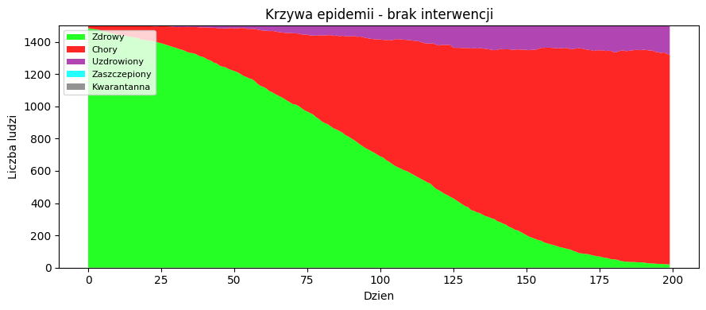
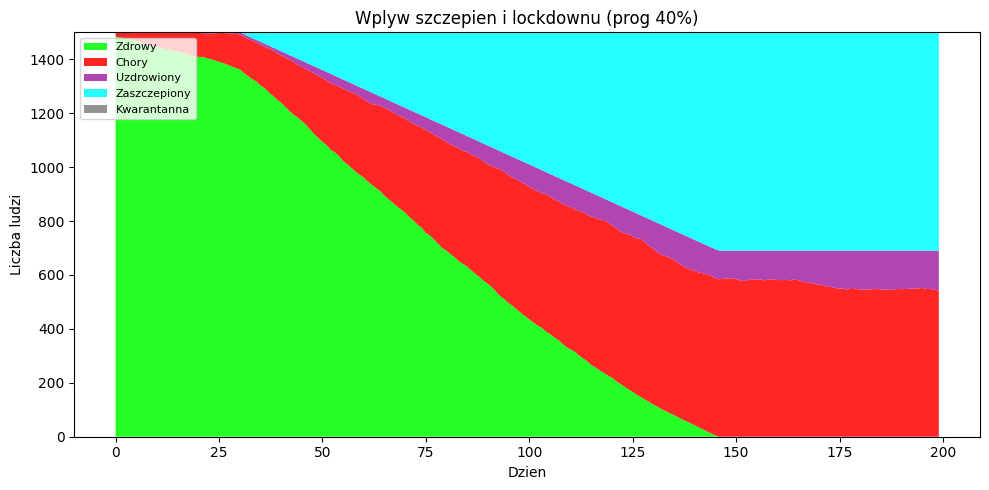

# Pandemic Simulator — Monte Carlo 

An agent-based Monte Carlo simulation of an epidemic. 1,500 people move randomly on a 140×140 grid for 200 days. Infected agents spread the virus to anyone within a contact radius with a given probability, and recover with some chance after a minimum illness period. The notebook compares how **vaccination** and a **lockdown** change the course of the outbreak.


## Experiments

| # | Scenario | What changes |
|---|----------|--------------|
| 1 | Baseline | No vaccines, no quarantine, recovered people can be reinfected |
| 2 | Vaccination + lockdown | Vaccination from day 30 (0.5% of population per day), lockdown when 40% are infected |
| 3 | Lockdown only | 80% of healthy people isolated once 30% are infected |

Agent states: healthy · infected · recovered · vaccinated · quarantined.

| Baseline | With vaccination |
|---|---|
|  |  |

## Parameters

All tunable at the top of the notebook: population `N`, grid size `GRID`, simulation length `N_STEPS`, initial infected, infection probability `P_INFECT`, recovery probability `P_RECOVER`, `CONTACT_RADIUS`, `RECOVERY_DELAY`, plus a fixed `SEED` for reproducible runs.

## Run it

```bash
git clone https://github.com/lucc1to/pandemic_simulator_montecarlo.git
cd pandemic_simulator_montecarlo
python -m venv .venv && source .venv/bin/activate
pip install -r requirements.txt
jupyter notebook pandemic_simulator.ipynb
```

Or open the notebook in VS Code with the Jupyter extension.

## Tech stack

Python · NumPy · Matplotlib · Jupyter

---
Built for a Monte Carlo methods course at AGH University (Computer Science & Intelligent Systems).
